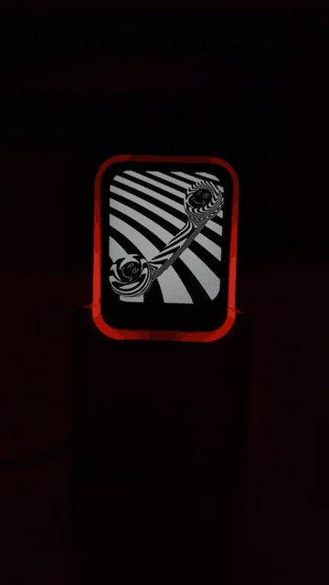

# Busy Tag Music Visualizer

Turns the seven LEDs of a [Busy Tag](https://busytag.com/) into a music visualizer for whatever your PC is playing, and shows the current cover art (TIDAL, Spotify, ...) on the display. Windows only, no firmware changes, no extra hardware, just USB.

- **Bottom LEDs (1 + 7):** red flash on every kick drum (detected at 40-80 Hz).
- **Upper LEDs (2-6), while kicks play:** soft pulse on the offbeat, colour changes every bar (blue, indigo, violet).
- **Upper LEDs, without kick:** colour follows the played frequencies (bass = blue, mids = indigo, highs = violet); each row follows its own frequency band.
- **Display:** cover art of the current track, filling the screen, updated on track change. Works with any player that reports its track to Windows (TIDAL, Spotify, Apple Music, browser players, ...). Without cover art the display is left alone; `--no-cover` turns it off.



## Two ways to run it

| | **A) `BusyTagVisualizer.exe`** | **B) `start.bat` (Python)** |
|---|---|---|
| Python needed | **No**, nothing to install | Yes, 3.9 or newer |
| Where | [Releases](../../releases/latest) page, download and double-click | this repository, double-click `start.bat` |
| First start | immediate | installs dependencies automatically (about a minute) |
| Good for | just using it | reading or changing the code |

Both do exactly the same. Windows SmartScreen may warn about the unsigned `.exe` ("More info" > "Run anyway"); if you prefer, use option B and read the code first.

## Requirements
- Windows 10/11
- Busy Tag (hardware 1.0, firmware 2.x) connected via USB
- Option B only: Python 3.9+ ([python.org](https://www.python.org/downloads/), tick "Add to PATH")

## Start
1. Close the Busy Tag desktop app (it blocks the USB port).
2. Start `BusyTagVisualizer.exe` (A) or `start.bat` (B).
3. Play music. Stop with `Ctrl+C` (the LEDs then switch off cleanly).

The Busy Tag is found automatically by its USB ID, so the COM number doesn't matter.

## Options
Run `BusyTagVisualizer.exe --help` or `start.bat --help` for all options. Pass them on the command line, or put them after the exe name in a shortcut. Useful ones:

| Option | Meaning |
|---|---|
| `--no-cover` | don't show the cover art |
| `--brightness 60` | limit brightness (1-100) |
| `--kick-share 0.2` | stricter kick detection (fewer false triggers); `0.08` = more sensitive |
| `--bpm 124` | start tempo for the offbeat pulse (adapts automatically) |
| `--port COM5` | set the port manually |

## How it works
- **Audio:** WASAPI loopback (any output device), FFT analysis, onset detection for the kick.
- **LEDs:** `AT+SC=<mask>,<RRGGBB>` over USB serial (460800 baud), sent from a background thread so the kick is never delayed.
- **Cover:** read from the Windows media session (SMTC), uploaded with `AT+UF`, shown with `AT+SP`. Uploading takes a few seconds, during which the LEDs pause briefly.

## Notes
- Written for firmware 2.x of the Busy Tag; the AT command set may differ on other versions.
- Not affiliated with Busy Tag. Use at your own risk.
- Tested with tracks around 128 BPM (house/techno); other genres may need tuning of `--kick-share`.

## License
MIT, see [LICENSE](LICENSE). You are free to use, change and share the code.

## Building the exe yourself
```
pip install -r requirements.txt pyinstaller
pyinstaller --onefile --name BusyTagVisualizer --collect-all winrt.windows.media.control --collect-all winrt.windows.storage.streams --collect-all winrt.windows.foundation --collect-all winrt.runtime --hidden-import winrt.windows.foundation.collections --collect-all pyaudiowpatch led_visualizer.py
```
The result is in `dist\`.
